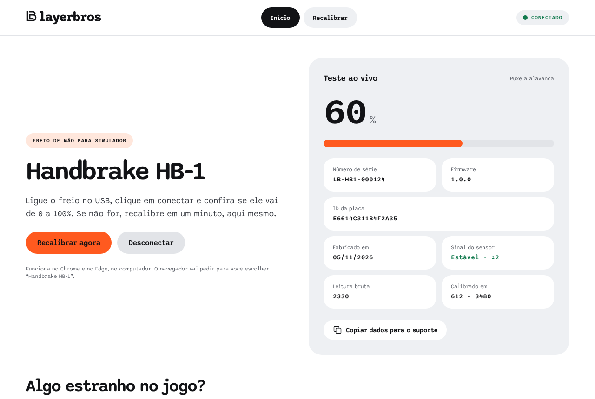

# LayerBros · Handbrake HB-1

Freio de mão USB para simulador. Uma **RP2040-Zero** lê um sensor hall **49E** e aparece no PC como **joystick** (um eixo e um botão). Um **site** grava o firmware na produção e deixa o cliente testar e recalibrar o freio pelo navegador, sem instalar nada.

**No ar:** https://hb1.layerbros.com (também em https://layerbros-hb1.pages.dev). A produção fica em `/admin/`, protegida pelo Cloudflare Access.



```
┌────────────┐  USB (HID + serial)   ┌──────────────────────────────┐
│  HB-1      │ ────────────────────▶ │ Jogo: joystick, eixo X       │
│ RP2040-Zero│                       └──────────────────────────────┘
│ + hall 49E │  Web Serial / WebUSB  ┌──────────────────────────────┐
│            │ ◀───────────────────▶ │ Site (Chrome/Edge)           │
└────────────┘                       │  /            teste ao vivo  │
                                     │  /recalibrar/ cliente        │
                                     │  /admin/     produção (login)│
                                     └──────────────────────────────┘
```

## Estado

| Parte | Situação |
|---|---|
| Firmware 1.0.0 | Compila sem avisos (~37 KB). **Ainda não testado numa placa real.** |
| Site | No ar. Fluxos testados de ponta a ponta com um HB-1 simulado. |
| Gravação de firmware pelo navegador | Implementada; precisa de teste com placa real. |
| Cloudflare Access no `/admin` | Configurado e testado. |
| Pendências antes de vender | [docs/pendencias.md](docs/pendencias.md) |

## O que tem aqui

| Pasta / arquivo | Conteúdo |
|---|---|
| [`firmware/`](firmware/) | Firmware em C (Pico SDK 2.1.1 + TinyUSB) |
| [`web/`](web/) | Site estático (HTML, CSS e JS puros, sem build) |
| [`web/firmware/`](web/firmware/) | O `.uf2` publicado e o `manifest.json` que a produção grava |
| [`tools/`](tools/) | Release do firmware, HB-1 simulado, testes e gerador de prints |
| [`docs/`](docs/) | Toda a documentação ([índice](docs/README.md)) |
| `wrangler.jsonc` | Alternativa de deploy como Worker de arquivos estáticos |
| `.github/workflows/ci.yml` | CI: compila o firmware e roda os testes do site |

## Começo rápido

Site local (Web Serial e WebUSB funcionam em `localhost` sem HTTPS):

```bash
npm run dev
```

Abra http://localhost:8080 no Chrome.

Firmware (precisa do Pico SDK, ver [docs/firmware.md](docs/firmware.md)):

```bash
PICO_SDK_PATH=~/pico-sdk tools/release-firmware.sh
```

Testes:

```bash
npm run check && npm test
```

```bash
node tools/e2e.mjs
```

O teste e2e e o gerador de prints (`node tools/screenshots.mjs`) precisam do Playwright com Chromium.

## Documentação

| Para | Leia |
|---|---|
| Montar o freio | [Hardware](docs/hardware.md) |
| Mexer no firmware | [Firmware](docs/firmware.md) · [Protocolo serial](docs/protocolo-serial.md) |
| Mexer no site | [Site](docs/web.md) |
| Operar a produção | [Produção: passo a passo](docs/producao.md) |
| Publicar e dar acesso | [Deploy no Cloudflare](docs/deploy.md) |
| Saber o que falta | [Pendências](docs/pendencias.md) · [Histórico de versões](CHANGELOG.md) |
| Agentes de IA | [AGENTS.md](AGENTS.md) |
