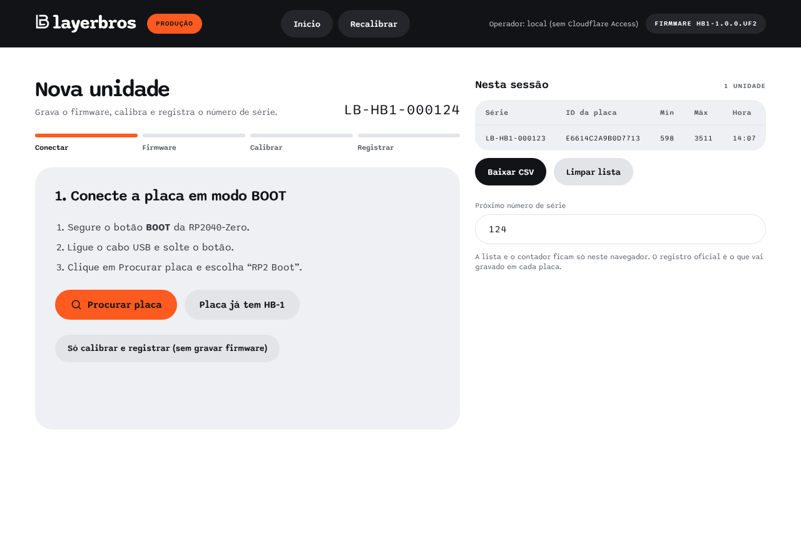

# Produção: passo a passo do operador

Endereço: **https://hb1.layerbros.com/admin/**. Use o **Chrome** ou o **Edge** no computador.

- **Login:** digite seu e-mail e o código que chega nele. Vale por 24 h. Seu e-mail precisa estar liberado ([deploy.md](deploy.md#tarefas-do-dia-a-dia)).
- **Cabeçalho:** mostra seu e-mail, o firmware que será gravado e atalhos para as telas do cliente (**Início** e **Recalibrar**). Use esses atalhos para conferir uma unidade como o cliente vai ver.
- **Favoritos:** as telas do cliente não têm link para a produção. Salve o endereço nos favoritos.



## Preparar o computador (uma vez)

### Windows: driver da gravação

O Windows não libera a interface de gravação da RP2040 para o navegador sem o driver **WinUSB**. Faça uma vez em cada PC de produção:

1. Baixe o **Zadig** em https://zadig.akeo.ie.
2. Coloque uma placa em modo BOOT (segure BOOT e conecte).
3. No Zadig: *Options → List All Devices*.
4. Escolha **RP2 Boot (Interface 1)**. Atenção: **Interface 1**, não a 0.
5. Driver de destino **WinUSB**, clique em *Install Driver*.

O pendrive RPI-RP2 continua funcionando. O cliente nunca precisa disso: a recalibração usa só a porta serial.

### Linux: permissão USB

```bash
echo 'SUBSYSTEM=="usb", ATTRS{idVendor}=="2e8a", MODE="0666"' | sudo tee /etc/udev/rules.d/60-rp2040.rules
```

```bash
sudo udevadm control --reload-rules && sudo udevadm trigger
```

### macOS

Nada a fazer.

## Antes de começar o lote

- Confira o firmware no topo da página (ex.: `FIRMWARE HB1-1.0.0.UF2`). Se aparecer "Firmware indisponível", o deploy está incompleto.
- Ajuste **Próximo número de série** na coluna da direita, se for o primeiro lote neste computador.

## Cada unidade

1. **Conectar**
   - Placa nova: segure **BOOT**, conecte o USB, solte. Clique em **Procurar placa** e escolha "RP2 Boot".
   - Placa que já tem HB-1: conecte normalmente e clique em **Placa já tem HB-1**. Ela reinicia em BOOT sozinha. Na primeira vez com cada placa, o navegador pede um clique em **Selecionar RP2 Boot**.
   - Só recalibrar ou registrar (sem regravar): **Só calibrar e registrar**.
2. **Gravar firmware.** Clique em **Gravar firmware**. Grava, verifica byte a byte e reinicia (alguns segundos). Não desconecte o cabo.
3. **Conectar o HB-1.** Em geral conecta sozinho. Se for a primeira vez com essa placa neste navegador, clique em **Conectar HB-1** e escolha "Handbrake HB-1". A página confere que o ID da placa é o mesmo do passo 1.
4. **Calibrar.**
   - Alavanca solta → **Gravar repouso**.
   - Alavanca no batente → **Gravar puxado**.
   - Se aparecer "Curso menor que 400", confira o ímã e a distância do sensor.
   - Confira o ruído (ideal ±6 ou menos).
5. **Registrar.** Confira série, ID, calibração e data e clique em **Gravar e finalizar**. A página relê a placa para confirmar.
6. **Pronto.** Desconecte, cole a etiqueta com a série mostrada e clique em **Próxima unidade**.

O LED confirma: verde piscando ao salvar, depois verde fraco.

## Lista da sessão

- Cada unidade finalizada entra na lista (série, ID da placa, mín, máx, hora).
- **Baixar CSV** exporta também firmware, data de fabricação, data/hora e operador. Guarde o CSV do dia: é o seu registro de produção.
- A lista e o contador ficam só neste navegador. Trocar de computador ou limpar dados do navegador zera os dois (as placas não mudam).

## Retrabalho (unidade devolvida)

- Placa que já tem série: o fluxo **mantém a série** e só atualiza firmware e calibração.
- Trocar a série de uma placa exige o comando `SET SERIAL!` por terminal serial ([protocolo-serial.md](protocolo-serial.md)). Evite.

## Problemas comuns

| Sintoma | O que fazer |
|---|---|
| "RP2 Boot" não aparece na lista | Confira se entrou em BOOT (aparece o pendrive RPI-RP2). Troque o cabo (precisa ser de dados). |
| "O navegador não conseguiu acessar a placa em modo BOOT" | Windows sem WinUSB na Interface 1 (veja acima) ou outro programa usando a placa (feche o picotool/Thonny). |
| "A gravação falhou" / "verificação falhou" | Desconecte, entre em BOOT de novo e repita. Persistindo, troque o cabo ou a porta USB (evite hub). |
| HB-1 não conecta depois de gravar | Clique em **Conectar HB-1**. Se não aparecer, desconecte e conecte o cabo. |
| "A placa conectada não é a mesma que foi gravada" | Há outro HB-1 ligado no PC. Deixe só a unidade em produção conectada. |
| Leitura não muda ao puxar | Fio OUT do 49E fora do GP26, sensor sem 3V3, ou ímã longe demais. |
| Ruído alto (±15 ou mais) | Fio do sensor longo ou perto de fonte de ruído. Adicione o capacitor de 100 nF. |
