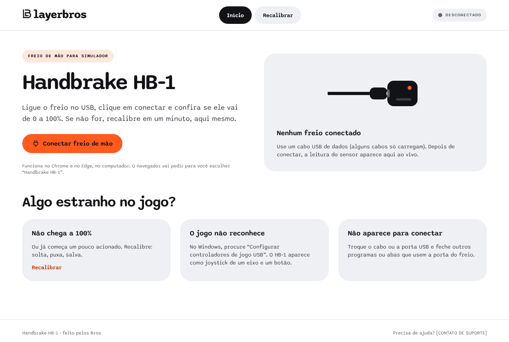
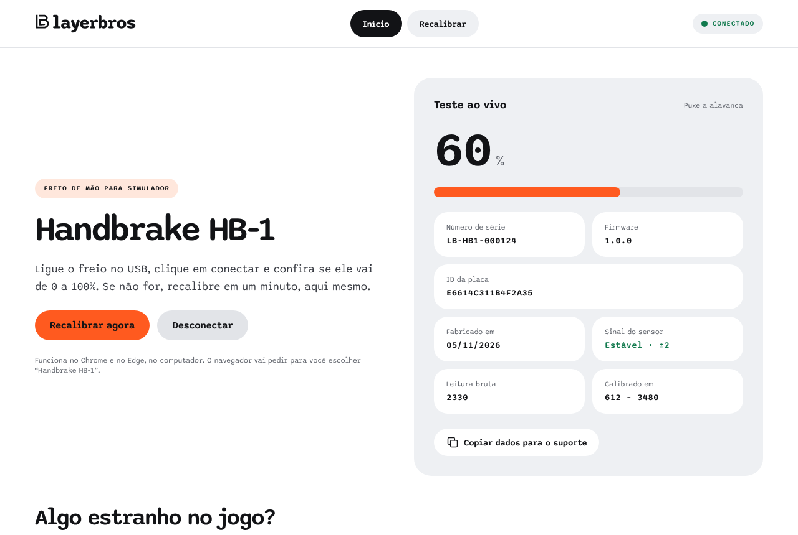
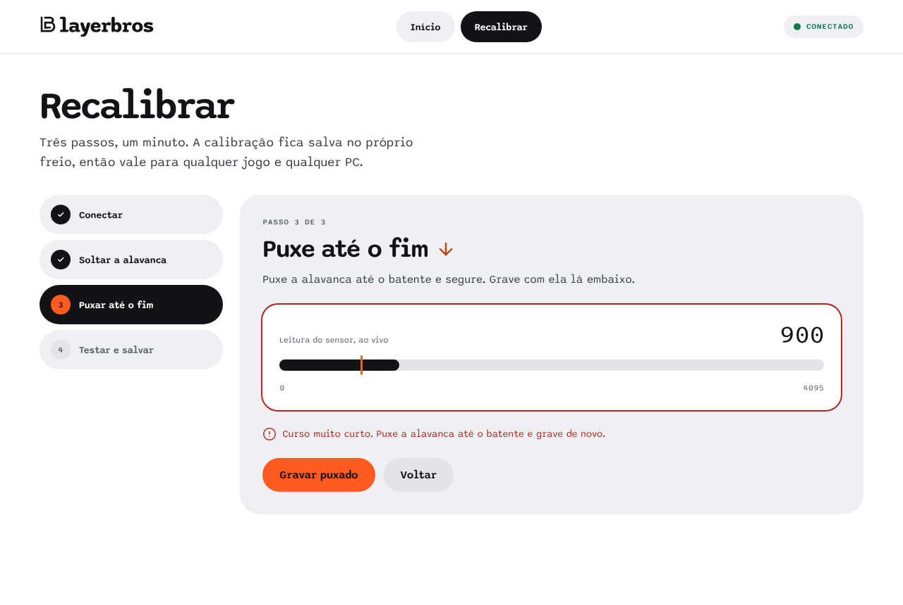
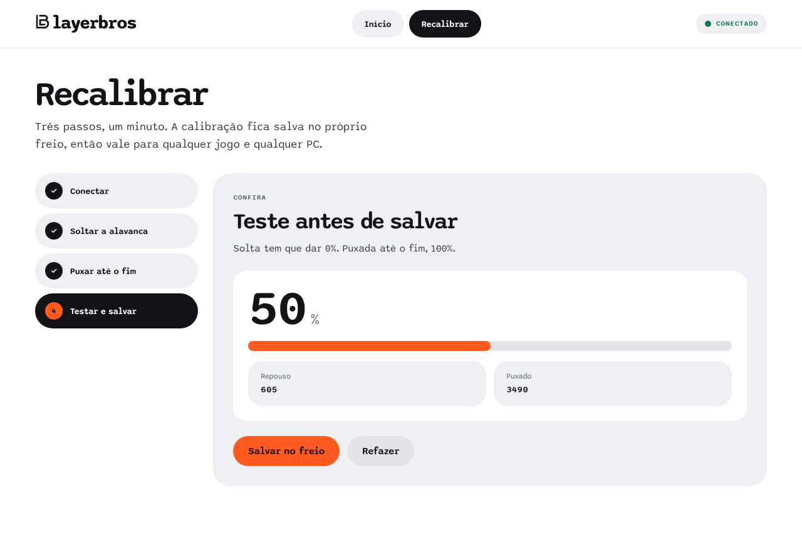
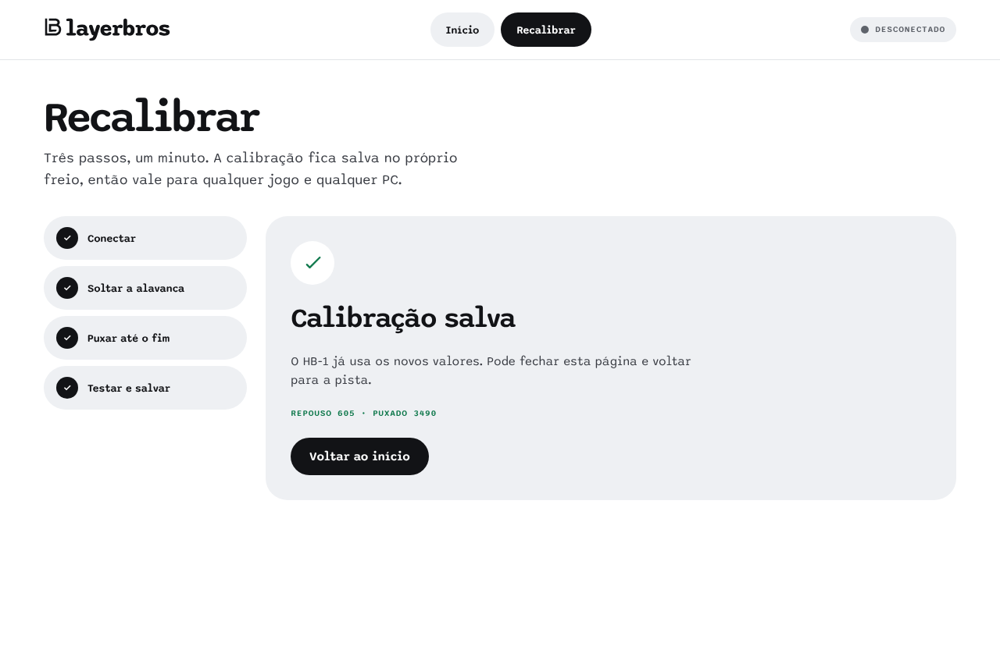
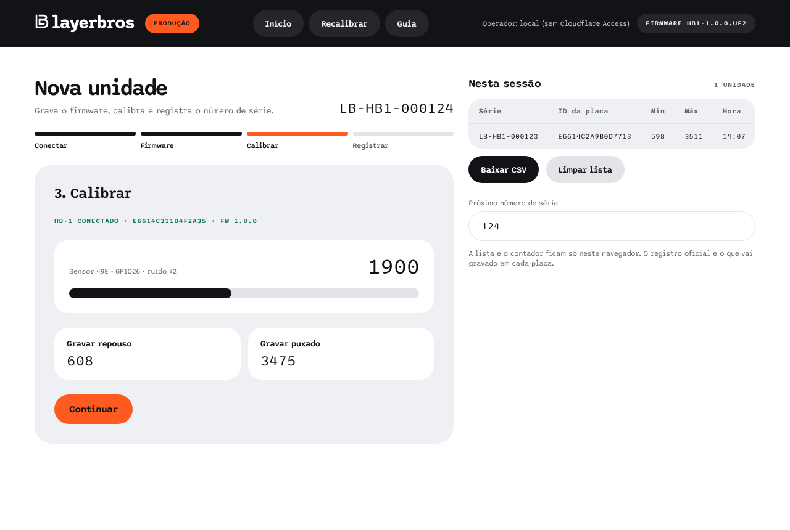
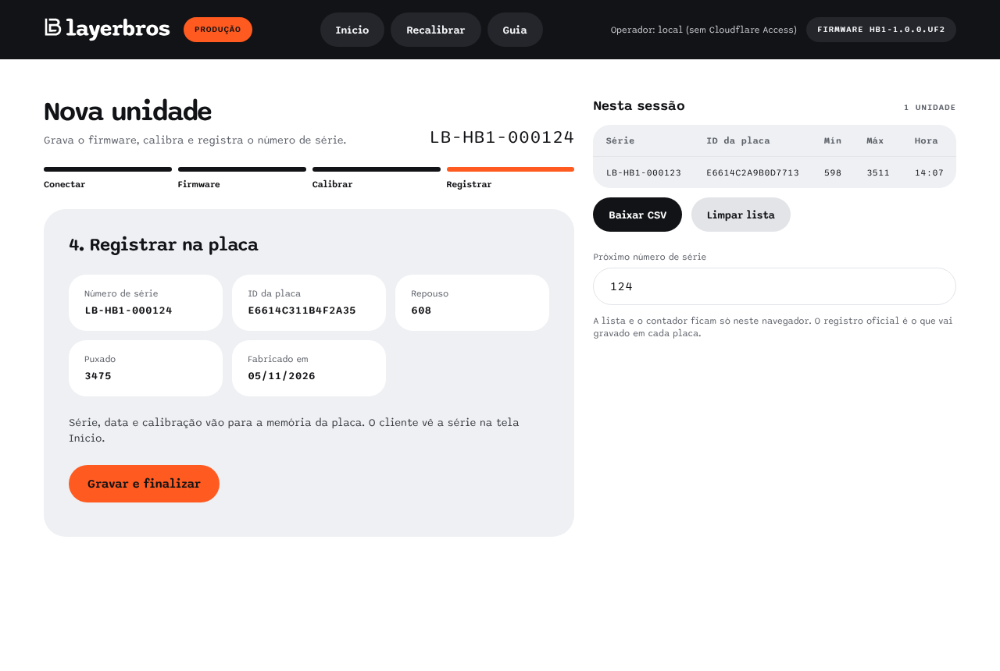
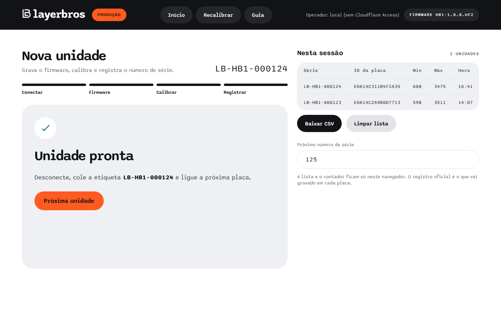
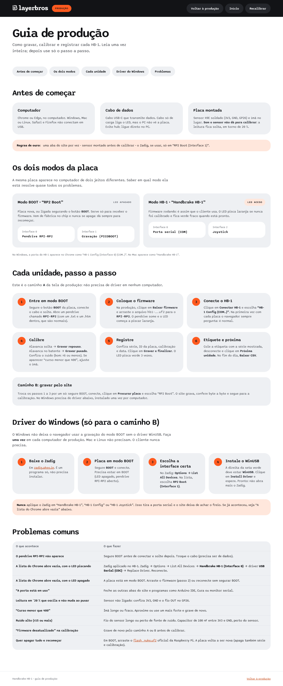

# Site

HTML, CSS e módulos ES puros. **Sem build e sem dependências.** A pasta `web/` é publicada como está no Cloudflare Pages (ver [deploy.md](deploy.md)).

## Telas

### Início (`/`), cliente

| Desconectado | Conectado |
|---|---|
|  |  |

- **Desconectado:** botão "Conectar freio de mão" e uma animação de um cabo USB-C entrando no freio, com o LED acendendo quando encaixa.
- **Conectado:**
  - posição ao vivo em % com barra;
  - dados da placa: número de série, firmware, ID da placa, data de fabricação, sinal do sensor (ruído), leitura bruta e calibração;
  - "Copiar dados para o suporte", que copia tudo isso mais o navegador usado.
- Avisa quando o freio nunca foi calibrado.
- Reconecta sozinho se o freio já foi autorizado neste navegador.
- No celular, os blocos empilham ([print](img/inicio-celular.png)). Mesmo assim, a conexão USB só funciona no computador.

### Recalibrar (`/recalibrar/`), cliente

Conectar → soltar (`CAL MIN`) → puxar (`CAL MAX`) → testar → salvar (`SAVE`).

| Curso curto | Teste antes de salvar | Salvo |
|---|---|---|
|  |  |  |

- Curso menor que 400: o card do sensor treme, ganha borda vermelha e mostra a mensagem.
- No passo de teste a % já usa a calibração nova (em RAM). Se a pessoa fechar a página sem salvar, a placa volta ao que estava gravado.

### Produção (`/admin/`), operador

Protegida pelo Cloudflare Access. O passo a passo do operador está em [producao.md](producao.md).

| Calibrar | Registrar | Pronta |
|---|---|---|
|  |  |  |

- O cabeçalho escuro mostra o operador (e-mail vindo do Access), o firmware que será gravado e atalhos para **Início**, **Recalibrar** e **Guia**.
- **Passo 1 com dois caminhos:**
  - **A. Arrastar o arquivo:** sem driver. "Baixar firmware" + "Conectar HB-1". Precisa só de Web Serial.
  - **B. Gravar pelo site:** WebUSB/PICOBOOT. No Windows exige WinUSB uma vez.
- Na calibração, avisa se o firmware da placa não é o `latest` do manifest.
- **`/admin/guia/`**: guia ilustrado do operador (modos da placa, passo a passo, Zadig, problemas). Também fica atrás do Access, por estar em `/admin/*`.


- As telas do cliente **não** têm link para o `/admin`, de propósito.

## Módulos

| Arquivo | Papel |
|---|---|
| `assets/js/hb1.js` | Classe `HB1`: Web Serial, fila de comandos, eventos `sample` e `disconnect`, filtro USB |
| `assets/js/picoboot.js` | Classe `Picoboot`: WebUSB + protocolo PICOBOOT do bootrom (apagar, gravar, verificar, reiniciar) |
| `assets/js/uf2.js` | `parseUF2()`: converte o `.uf2` em setores de 4 KB |
| `assets/js/ui.js` | Etapas, medidores, efeitos e mensagens de erro em português (`MESSAGES`) |
| `assets/js/home.js`, `recalibrar.js`, `admin.js` | Lógica de cada tela |
| `assets/css/lb.css` | Tokens LayerBros (claro e escuro), componentes e animações |
| `assets/img/` | Logos do design system LayerBros e favicon |
| `firmware/` | `.uf2` publicado + `manifest.json` (gerados por `tools/release-firmware.sh`) |
| `_headers` | Cabeçalhos de segurança do Cloudflare |

## Movimento

Curto e com propósito; tudo desligado em `prefers-reduced-motion`.

| Efeito | Onde |
|---|---|
| Entrada suave (`.rise`) | Títulos e cada passo dos assistentes |
| Cabo USB-C conectando | Início desconectado |
| Bolinha "Conectado" pulsando, anel no passo atual | Cabeçalho, listas de etapas |
| Tremida + borda vermelha (Transitions.dev *error-state-shake*) | Curso curto (Recalibrar e Produção) |
| ✓ desenhado (*success-check*) | Calibração salva, unidade pronta |
| Brilho no texto (*shimmer-text*) + listras na barra | Gravando firmware, reiniciando em BOOT |
| Dígitos subindo (*number-pop-in*) | Valores capturados na Produção |

## Navegadores

| | Web Serial (cliente) | WebUSB (produção) |
|---|---|---|
| Chrome / Edge no computador | Sim | Sim |
| Opera | Sim | Sim |
| Firefox, Safari | Não | Não |
| Celular | Não | Não (Android tem WebUSB, mas não Web Serial) |

As telas mostram um aviso e desativam os botões quando a API não existe. As APIs exigem HTTPS ou `localhost`.

## Gravação de firmware (PICOBOOT)

Em modo BOOT a RP2040 expõe uma interface USB vendor (classe `0xFF`) com o protocolo PICOBOOT, o mesmo do `picotool`. A sequência em `picoboot.js`:

1. `INTERFACE_RESET` (controle).
2. `EXCLUSIVE_ACCESS` (trava o pendrive RPI-RP2 durante a gravação).
3. `EXIT_XIP`.
4. Para cada setor de 4 KB do `.uf2`: `FLASH_ERASE` e `WRITE`.
5. `READ` de cada setor e comparação byte a byte.
6. `REBOOT`.

Antes de gravar, a produção baixa o `.uf2` indicado no `manifest.json` e confere o sha256.

O ID único da placa aparece como número de série USB tanto no modo BOOT quanto no firmware. A produção compara os dois para garantir que calibra a mesma placa que acabou de gravar.

## Desenvolvimento e testes

```bash
npm run dev
```

| Comando | O que faz |
|---|---|
| `npm run check` | Sintaxe de todos os módulos JS |
| `npm test` | Testes `node:test` (UF2, manifest, limite da flash) |
| `node tools/e2e.mjs` | As três telas num Chromium com HB-1 simulado, sem erros de JS e sem rolagem lateral em 375 px |
| `node tools/screenshots.mjs` | Regera as imagens de `docs/img/` |

O `tools/fake-hb1.js` substitui `navigator.serial` por uma porta falsa que segue o [protocolo](protocolo-serial.md). Nos scripts, `window.__hb1.raw` simula a alavanca. **A gravação USB não é simulada:** teste com uma placa real.

## Segurança

- `web/_headers`:
  - CSP: só scripts do próprio site; estilos do site e do Google Fonts; nada de terceiros;
  - `Permissions-Policy`: libera `serial` e `usb` só para o próprio site;
  - `noindex` e `no-store` no `/admin`.
- O `/admin` não tem senha no código: a proteção é do Cloudflare Access ([deploy.md](deploy.md)).
- O site não envia dados para servidor nenhum. A lista da produção fica no `localStorage` do navegador do operador.
